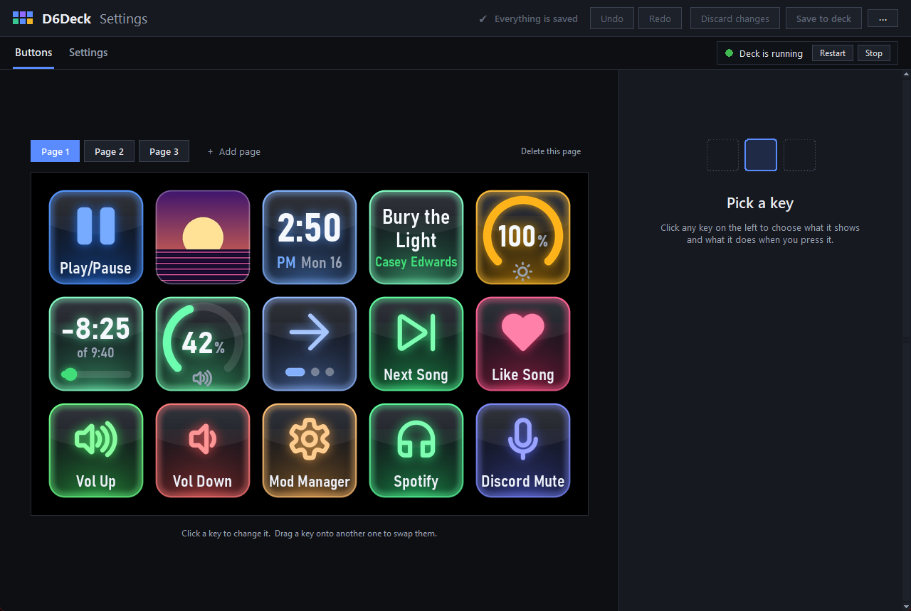

# D6Deck

**A free, open-source, offline app for the Fifine AmpliGame D6 stream deck (15 screen keys).**

No account, no cloud, no internet needed. It runs quietly in the background on Windows and gives
your D6 animated keys, live info, three pages of buttons, a screen saver and even mini-games.
Everything is set up in a simple desktop window: click a key, choose what it shows and what it
does, then press **Save to deck**.



> 🤖 **Made with AI.** D6Deck was designed and built with
> [Claude Code](https://claude.com/claude-code), Anthropic's AI coding assistant, working together
> with the project's owner, who described what they wanted and tested every change on a real D6.

## What it does

- **Page 1 – Music:** album cover of the song playing in Spotify (press it to go back a song),
  song name, time left, play/pause, next, like, volume knob, Spotify launcher, Discord mute.
- **Page 2 – PC:** CPU/RAM status, Task Manager, screenshot, launch apps (even as admin),
  file explorer, key brightness, screen off, show desktop, lock PC.
- **Page 3 – Fun:** live CPU and RAM meters, stopwatch, theme switcher, and games:
  Whack-a-mole, Simon, Lights Out, Reaction test, Memory, Dice, Coin flip, 8-Ball, Party mode.
- **Page 4 – Notes & gaming:** Obsidian keys (open vault, today's note, new note, search, Inbox,
  Clip It) and **Game Mode**: press twice to close memory-hungry apps before you play.
- **Doesn't freeze when the PC turns off:** the D6 is put to sleep on shutdown and sleep.
- **Picture for when the PC is off:** save your own still picture inside the D6 itself.
- **Smooth animations** on every press and page change.
- **4 looks:** Neon, Vivid, Mono and Classic.
- **Screen saver:** "Screen Off" plays a screen saver. Use one of the built-in ones, or your own
  picture or GIF stretched across all 15 keys like one big screen. Press any key to wake it.
- **Smart app finding:** if a button points to a program that is somewhere else on your PC
  (another drive, a different install folder), D6Deck finds it on its own, so shared button
  setups work on other computers too.
- **Waits for the deck:** start it before plugging in the D6, or unplug and replug, and it
  picks the deck back up by itself.
- **Live reload:** changes from the settings window show up on the deck right away.

## Download (easiest – no Python needed)

1. Go to [**Releases**](../../releases/latest) and download **`D6Deck.exe`**.
2. Make a folder for it (for example `Documents\D6Deck`) and put the exe there. Your buttons and
   settings get saved in that same folder.
3. Double-click **D6Deck.exe**. The settings window opens. Click **Start** in the top right.

Windows may show "Windows protected your PC" because the exe isn't signed by a paid
certificate. Click **More info → Run anyway**. The full source code is right here if you want to
check it or build it yourself.

> **Tip:** close the official Fifine software first, because only one app can talk to the D6 at a
> time. To make D6Deck start with Windows, turn it on in the **Settings** tab of the app.

## Install from source (Windows 10/11)

1. Install [Python 3](https://www.python.org/downloads/) and tick **"Add python.exe to PATH"**.
2. Download this project (green **Code** button → **Download ZIP**) and unzip it anywhere.
3. Double-click **`install.bat`**. It installs what D6Deck needs and puts a **D6Deck** icon on
   your Desktop.
4. Plug in your D6 and open **D6Deck** from the Desktop. Click **Start** in the top right.

To build the exe yourself: `py -m pip install pyinstaller`, then run `build_exe.bat`.

## Discord mute key

Discord doesn't let other apps mute it directly, so the key presses a shortcut. In Discord open
**Settings → Keybinds**, add **Toggle Mute** and set it to `Ctrl + Shift + Alt + M`.

## Command line (optional)

These work with `D6Deck.exe` too, for example `D6Deck.exe start`.

```
py d6deck.py ui               open the settings window
py d6deck.py start            run in the background
py d6deck.py stop / restart
py d6deck.py install-startup  start with Windows
py d6deck.py shortcuts        make Desktop icons
py d6deck.py check            test volume + Spotify info without the deck
py d6deck.py offscreen PIC    save a still picture in the D6 for when the PC is off
py d6deck.py pretend-off      test the "PC is shutting down" handling
py d6deck.py --version        show which version you have
```

## What's new

See [CHANGELOG.md](CHANGELOG.md) for everything added, fixed and removed in each version.

## Files

| File | What it is |
| --- | --- |
| `d6deck.py` | The app: talks to the D6, runs the keys, live info |
| `d6look.py` | How keys look: themes, icons, live keys |
| `d6fun.py` | Screen savers, games and toys |
| `d6ui.py` | The settings window |
| `d6layout.py` | The default buttons for new installs |
| `install.bat` | One-click setup when running from source |
| `build_exe.bat` | Builds `D6Deck.exe` yourself |
| `CHANGELOG.md` | What changed in each version |

Your own setup (`buttons.json`, `config.json`, `state.json`, your screen saver picture) is created
next to these files on first run and is never uploaded anywhere.

## Open source

D6Deck is open source under the [MIT License](LICENSE): use it, change it, share it.
Ideas, bug reports and improvements are welcome. Open an issue or a pull request.
Found a security problem? Please report it privately, see [SECURITY.md](SECURITY.md).

D6Deck is a fan project and is not made by or connected to Fifine.
